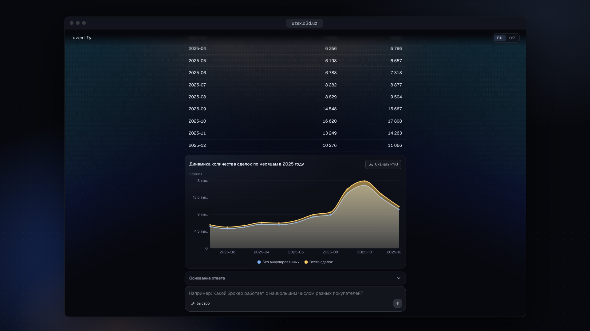
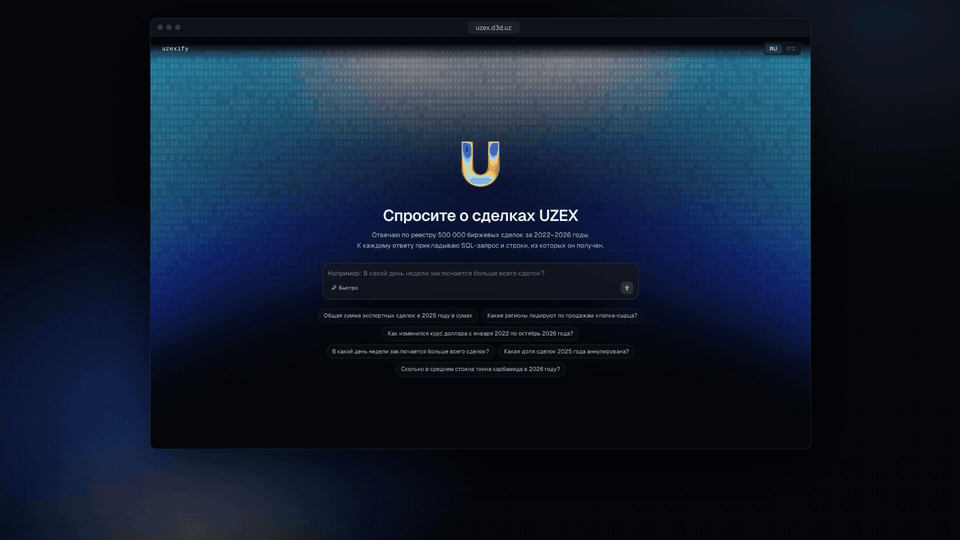
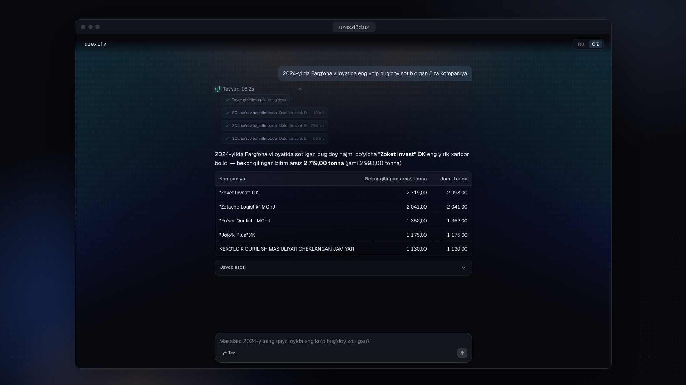
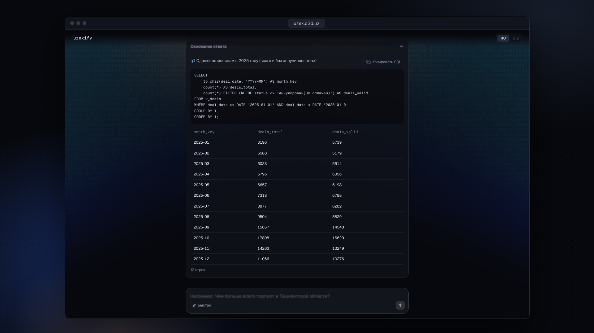
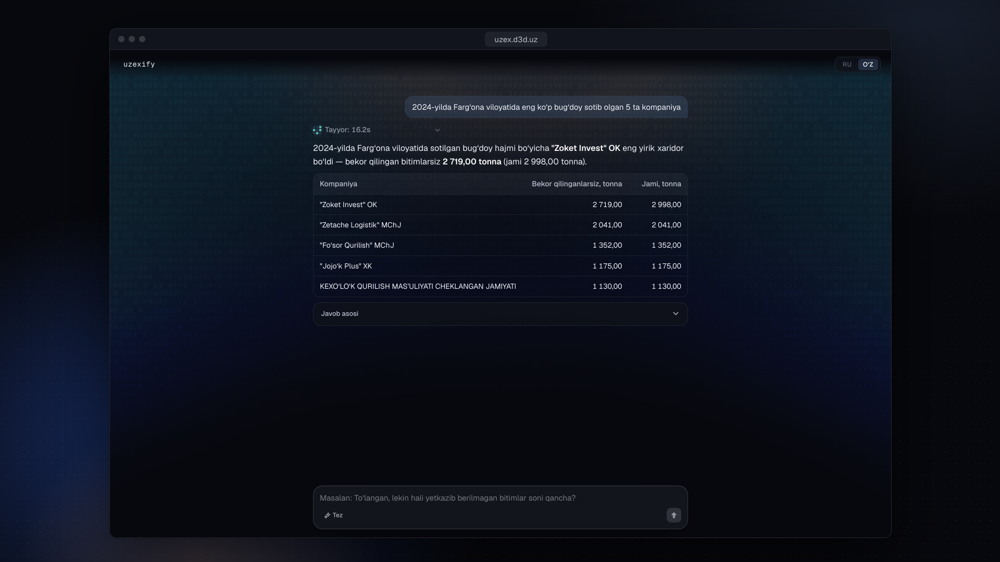
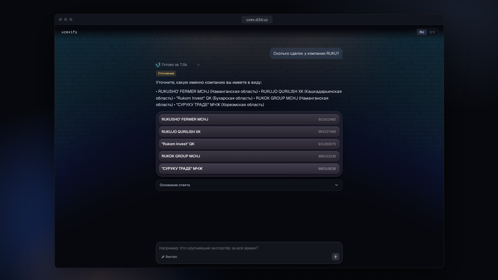
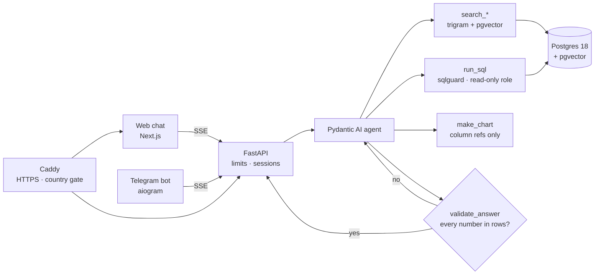

<h1 align="center">UZEXify</h1>

<p align="center">
  <strong>Ask about 500,000 exchange deals in Russian or Uzbek. Get the number, the SQL behind it and the rows it came from.</strong>
</p>

<p align="center">
  <a href="https://uzex.d3d.uz">Live demo</a> ·
  <a href="docs/solution.md">Write-up (RU)</a> ·
  <a href="docs/style.md">Answer style</a> ·
  <a href="data/uzex_spot_data/README.md">Data</a> ·
  <a href="AGENTS.md">Repository guide</a>
</p>

<p align="center">
  
</p>

<p align="center">
  <sub><em>Every number in the answer is checked against the rows of the query that produced it.</em></sub>
</p>

---

## What is this, really?

UZEXify is an AI agent over the deal registry of the Uzbek Republican Commodity Exchange (UZEX): 500,000 deals from 3 January 2022 to 30 October 2026. It was built for the [UZEX AI Hackathon 2026 qualifier](https://hackathon.uzex.uz/saralash/?lang=ru#task).

You type a question the way you would ask a colleague: in Russian, in Uzbek Latin or in Uzbek Cyrillic, with typos, with company names in any script. The agent finds the companies and products you meant, writes one read-only `SELECT`, runs it against Postgres and answers in your language.

The rule it lives by: **no number without a query.** The answer ships with the SQL and its result rows, and before it leaves the server every number in the text is matched against those rows. If a number is not there, the model has to recompute it. If the data has no answer, it says so.

The data in this repository is synthetic. It mirrors the format of the public registry; any resemblance to real organisations is coincidental.

<p align="center">
  
</p>

---

## Things you can ask

- **«Сколько сделок было заключено в 2024 году?»** One number, one query, done.
- **«Как менялось число сделок по месяцам в 2025 году?»** A line chart, drawn from the query's rows rather than from anything the model typed.
- **«2024-yilda Farg‘ona viloyatida eng ko‘p bug‘doy sotib olgan 5 ta kompaniya»** Uzbek in, Uzbek out. *Bug‘doy* resolves to wheat through hybrid product search.
- **«Объём экспорта в долларах и в сумах по годам»** USD deals converted to UZS at the rate of each deal's date. Dollars and sums never share an axis.
- **«а по месяцам?» · «покажи на графике»** Follow-ups keep the topic of the previous turn.
- **«Как зовут директора компании с ИНН 921912462 и каков его телефон?»** The registry has no such fields, so the answer is a plain "no data", not a guess.

---

## A look inside

<table>
  <tr>
    <td width="50%" valign="top">
      <br>
      <sub><strong>You watch it work.</strong> Each tool call streams in as it happens: what it searched, what it ran.</sub>
    </td>
    <td width="50%" valign="top">
      <br>
      <sub><strong>Evidence.</strong> The exact SQL and every row it returned.</sub>
    </td>
  </tr>
  <tr>
    <td width="50%" valign="top">
      <br>
      <sub><strong>Russian, O‘zbekcha, Ўзбекча.</strong> The answer follows the script of the question.</sub>
    </td>
    <td width="50%" valign="top">
      <br>
      <sub><strong>It asks when it should.</strong> Several companies match the name? It lists them instead of picking one.</sub>
    </td>
  </tr>
</table>

---

## Why the numbers hold up

Most chat-over-data demos trust the model to copy numbers correctly. This one does not.

1. **Read-only by construction.** The agent connects as `uzex_agent`: `SELECT` only, read-only transactions, a statement timeout. `sqlguard` additionally rejects anything but one `SELECT` over the registry tables before it reaches the database.
2. **Numbers are checked.** `output.validate_answer` extracts every number from the answer («106 647», «13,16 трлн сумов», «6,98 %») and matches it against the evidence rows at the displayed precision. A miss sends the model back to compute it with a query.
3. **No query, no answer.** An answer without executed SQL is rejected outright.
4. **Charts can't lie.** The model only names columns of an executed query; the server draws the values from the rows. `/api/chart.png` re-validates every chart against its evidence.
5. **Fallback is still grounded.** If the model fails after the SQL has run, the user gets the query result with a warning instead of model text.

---

## Quality

On a 42-question control set in three scripts (34 answerable, 6 with no data, 2 that need clarification); reference values are computed by SQL at check time:

| Metric | Result |
|---|---|
| Correct answers | **34 of 34** |
| Invented answers where data is missing | **0** |
| Clarifications asked when needed | 2 of 2 |
| Answered in the question's language and script | 42 of 42 |
| Multi-turn dialogs (3 × 6 turns) | 18 of 18 turns |
| Product search: right product in top 5 (52 mentions, 3 scripts) | 93.3 % |
| Company search: false matches on made-up names | 0 |

Details and every run report: [`docs/solution.md`](docs/solution.md), [`backend/evals/reports/`](backend/evals/reports/).

---

## Works today · Not doing

| ✅ Works today | 🚫 Deliberately not doing |
|---|---|
| Web chat: RU / UZ, live steps, thinking depth, charts with PNG download, evidence panel, mobile layout | Forecasts and "what will happen" questions |
| Telegram bot on the same API: live progress, evidence, charts as images | Answers about people and contacts |
| Counts, sums, volumes, average prices, shares by product, company, broker, region, trade type, status | Anything outside 2022-01-03 … 2026-10-30 |
| Company and product search across scripts and typos; clarifying questions | Writing to the database, ever |
| USD → UZS at the deal date's rate | Numbers the query did not return |
| Short conversation memory (last 4 turns) | |

---

## Getting started

### I just want to try it

Open **<https://uzex.d3d.uz>**, no sign-up. The site serves visitors from Uzbekistan only (country gate on the edge); elsewhere, run it locally.

### I want to run it locally

You need Docker, [mise](https://mise.jdx.dev) (installs uv and Bun) and an OpenAI-compatible LLM endpoint.

```sh
git clone https://github.com/cummanda-veka/uzexify_agent.git && cd uzexify_agent && mise install
cp .env.example .env            # LLM and embedding endpoints, keys, DB passwords
docker compose up -d db

cd backend && uv sync
uv run uzexify ingest --data-dir ../data/uzex_spot_data   # schema, 500,000 deals, read-only agent role
uv run uzexify embed            # product embeddings
uv run uzexify ask "Сколько сделок было заключено в 2024 году?"
uv run uzexify serve            # API on :8000

cd ../web && bun install && NEXT_PUBLIC_API_BASE=http://localhost:8000 bun dev
```

Telegram bot: `uv run uzexify bot` with `TELEGRAM_BOT_TOKEN` set.

### I want my own server

GitHub Actions builds the images on every push to `main`. One command copies the config and `.env` to the host over SSH, pulls the images, starts the stack and loads the data on first run:

```sh
scripts/deploy.sh user@host          # add --bot for the Telegram bot
```

Set `PUBLIC_HOST` in `.env` and point its DNS at the host. HTTPS comes from a shared Caddy on the host that owns ports 80/443 (`/opt/edge`: `compose.yaml` with an external `edge` network, a `Caddyfile` importing `sites/*.caddy`); the deploy installs `uzexify.caddy` there and reloads it, and Caddy gets the certificate.

---

## Architecture



The API streams `step` events (each tool call and result), then one `answer` or one `error`. See [AGENTS.md](AGENTS.md) for the full map.

<details>
<summary><strong>Code map</strong></summary>

**Agent** (`backend/src/uzexify/agent/`) — `prompt.py` system prompt and answer style · `tools.py` search, SQL, chart tools · `output.py` answer schema and grounding check · `models.py` model and fallback setup

**Server** — `api/` FastAPI app, rate limits, concurrency gate, geo gate · `bot/` Telegram bot · `sqlguard.py` SQL validation · `search.py` entity search · `charts.py` server-side charts · `typograph.py` number formatting · `ingest.py` CSV → Postgres

**Web** (`web/`) — `src/app/page.tsx` the chat client · `src/components/chat/` answer, evidence, chart, steps

**Quality** (`backend/evals/`) — golden, dialog, style and retrieval evals with YAML datasets

**Design** (`design/`) — HyperFrames projects: bot banner, README images

</details>

| Part | Technology |
|---|---|
| Agent | Pydantic AI |
| API | FastAPI, SSE |
| Database | PostgreSQL 18 + pgvector |
| Web | Next.js 16, React 19, shadcn/ui, Bun, Biome |
| Telegram | aiogram 3 |
| Observability | Langfuse |
| Deployment | Docker Compose, Caddy, mise (uv + Bun) |

---

## Going further

- **[docs/solution.md](docs/solution.md)** — the hackathon write-up (RU): design, grounding, model comparison, quality
- **[docs/style.md](docs/style.md)** — how answers are worded and formatted
- **[data/uzex_spot_data/README.md](data/uzex_spot_data/README.md)** — fields and formulas of the registry
- **[AGENTS.md](AGENTS.md)** — repository guide: commands, conventions, invariants

<details>
<summary><strong>Checks</strong></summary>

```sh
cd backend
uv run pytest                                            # pure unit tests, no DB or LLM
uv run python -m evals.run --target local --label NAME   # golden set: correctness, grounding, language, latency
uv run python -m evals.dialog_run --label NAME           # multi-turn memory
uv run python -m evals.style_run --label NAME            # style lint + LLM judge
uv run python -m evals.retrieval --variants lexical,hybrid-gemini
```

</details>

---

## What it is not

- Not a text-to-SQL toy. The SQL is the evidence, and the answer is checked against it.
- Not a forecaster. It reports what the registry says, for the dates the registry covers.
- Not a replacement for the official registry: the data here is synthetic.

---

## Third-party data

`geo/dbip-country-lite.mmdb` is the [DB-IP IP to Country Lite](https://db-ip.com/db/download/ip-to-country-lite) database, licensed under [CC BY 4.0](https://creativecommons.org/licenses/by/4.0/). IP Geolocation by [DB-IP](https://db-ip.com).

<p align="center">
  <sub>UZEXify · built for the UZEX AI Hackathon 2026</sub>
</p>
