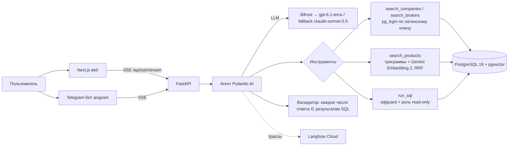

# UZEXify — описание решения

Веб: <https://uzex.d3d.uz> (без регистрации). API: `POST https://uzex.d3d.uz/api/ask`.

> **O‘zbekcha qisqacha.** UZEXify — 500 000 ta birja bitimi bo‘yicha savollarga rus va o‘zbek (lotin/kirill) tillarida
> faqat ma’lumotlar asosida javob beradigan agent. Barcha raqamlar SQL orqali hisoblanadi; javobdagi har bir raqam
> so‘rov natijalari bilan tekshiriladi. Kompaniya yoki tovar topilmasa, agent «ma’lumot yo‘q» deb javob beradi.
> Sifat 38 ta nazorat savoli bilan o‘lchandi: «javob» savollarida aniqlik 90–97%, ma’lumot yo‘q savollarida xavfli
> javoblar — 0.

## Архитектура

Поток: вопрос → агент находит сущности (компания, брокер, товар) → строит и выполняет SELECT → формулирует ответ.
Валидатор вывода проверяет, что все числа текста взяты из результатов инструментов. Если нет, модель получает
`ModelRetry` и должна посчитать число в SQL. Ответ возвращается с «основанием»: SQL, строки результата, найденные
сущности.

## Стек

| Слой | Решение | Почему |
|---|---|---|
| LLM | `gpt-6.1-terra` (основная), `claude-sonnet-5.5` (fallback) через шлюз Bifrost | Выбраны по бенчмарку: точность в пределах 1 кейса от лучшей, p95 13,8 с против 21,7 с, ниже цена |
| Агент | Pydantic AI 2.66 | Типизированные инструменты, `output_validator` + `ModelRetry`, `FallbackModel`, `UsageLimits`, стрим событий, OTel |
| Поиск компаний и брокеров | Ключ имени: NFKC → casefold → без апострофов → кириллица→латиница → без правовых форм (MCHJ, МЧЖ, XK…); `pg_trgm` | «ҲАРАЙЎМ КИМЁ» МЧЖ и «Harayo‘m Kimyo» дают один ключ `harayom kimyo`. Имена выдуманные: эмбеддинг не несёт смысла и всегда выдаёт «ближайшего». Триграммы дают честное «не найдено» |
| Поиск товаров | Триграммы (термин + русский перевод) + векторы `google/gemini-embedding-2` (OpenRouter), слияние RRF | Векторы нужны там, где есть смысл и межъязыковой перенос: bug‘doy → пшеница, paxta → хлопок, o‘g‘itlar → карбамид/селитра |
| Реранкер | Нет в рантайме | В бенчмарке `cohere/rerank-5-fast` ухудшил recall@5 (78,9% против 93,3%) |
| БД | PostgreSQL 18 + pgvector 0.8.7 | Данные и эмбеддинги в одной БД; 697 векторов — точное сканирование без ANN |
| API | FastAPI, SSE (sse-starlette), psycopg 3 pool | Живые шаги агента в вебе и боте |
| Веб | Next.js 16, React 19, Tailwind 4, shadcn/ui, Biome, bun | Чат, живые шаги, панель «Основание ответа» (SQL + таблица) |
| Бот | aiogram 3.31, `sendMessageDraft` для прогресса | Тот же API, раскрываемая цитата с основанием |
| Наблюдаемость | Langfuse Cloud, `Agent.instrument_all()` | Трасса на каждый вопрос: модель, вызовы инструментов, сеанс, канал, язык; оценки прогонов бенчмарка |
| Бенчмарки | pydantic-evals 2.66 | Детерминированные оценщики на Python, параллельный прогон, JSON-отчёты |
| Деплой | Docker Compose + Caddy (авто-HTTPS) на VPS | Наружу открыты только 80/443 |

**Нужны ли эмбеддинги?** Только для товаров. Справочники (статусы, типы торгов, валюты, единицы, категории,
регионы) закрыты и вместе с каталогом 230 товаров лежат в промпте. Компании ищутся лексически с транслитерацией:
это точнее векторов и позволяет честно ответить «не найдено».

## Меры против выдуманных ответов

1. **Роль БД `uzex_agent`** — только `SELECT`, `default_transaction_read_only`, `statement_timeout`, без `TEMP`.
2. **sqlguard** (sqlglot): один оператор; корень — SELECT/UNION; запрещены DML/DDL, `pg_sleep`, `dblink*` и т. п.;
   разрешены только таблицы данных. Выполнение — `SET TRANSACTION READ ONLY` + лимит строк.
3. **Проверка чисел.** Из текста ответа извлекаются все числа: «1,2 млрд», «106 647», «3 751,5». Каждое должно
   совпасть с числом из результатов SQL или найденных сущностей с точностью до показанного разряда. Иначе модель
   получает повтор с требованием посчитать это значение в SQL.
4. **`kind=answer` невозможен без успешного SQL.**
5. **Правила промпта:** компания или товар не найдены → `no_data` без подстановки похожих; несколько кандидатов →
   `clarify` (без чисел); период вне 03.01.2022–30.10.2026 → `no_data`; люди, контакты, прогнозы → `no_data`.
   Суммы без указанного статуса даются двумя цифрами: все записи и без «Аннулирован(Не оплачен)».
6. Если ответ не прошёл проверку после повторов, пользователь видит честную плашку и сырой результат SQL, а не
   текст модели.

## Как проверяли

**Набор `backend/evals/golden.yaml`** — 38 вопросов: 21 на UZ-латинице, 8 на UZ-кириллице, 9 на RU. Ожидаемые
виды: 30 `answer`, 6 `no_data` (2021 год, 2027 год, несуществующая компания, директор/телефон, золото, курс евро),
2 `clarify`. Категории: количество за период, суммы по товару с валютой, средняя цена, топ-N, компания в другой
письменности, брокеры, контракт, сделка по номеру, статусы, экспорт с пересчётом в сумы, регион склада,
относительные периоды. Эталон — `reference_sql`, он выполняется в момент прогона.

**Оценщики:** вид ответа; присутствие эталонных значений (числа — с допуском показанной точности); отсутствие
чисел в `no_data`/`clarify`; язык и письменность; время ≤ 90 с.

**Выбор модели** (локально, одна БД, параллельность 3):

| Модель | answer | небезопасные no_data | p50, с | p95, с |
|---|---|---|---|---|
| claude-sonnet-5.5 | 29/30 | 0/6 | 14,9 | 21,7 |
| gemini-4-argon-high | 29/30 | 0/6 | 12,5 | 27,8 |
| **gpt-6.1-terra** | 28/30 | 0/6 | 8,0 | 13,8 |

Правило выбора задано заранее: исключить модели с небезопасными ответами, затем взять максимум точности, при
разнице ≤ 1 кейса — меньший p95. Разбор провалов: у всех моделей `region_100003` отвечен верно, но в падежной форме
(«в Ферганской области»), а оценщик ищет точное вхождение.

**Прод** (`https://uzex.d3d.uz`, `--target http`, gpt-6.1-terra): `answer` 28/30, небезопасных `no_data` 0/6,
язык 36/38, p50 7,7 с, p95 14,4 с. Оба провала в `answer` — артефакты оценщиков, ответы верные: падежная форма
региона; название компании в кавычках “…” вместо «…», из-за чего оценщик письменности его не вычел. По ходу
прогонов исправлены две настоящие ошибки: относительный период, частично выходящий за данные, и разовые обрывы
соединения со шлюзом (добавлены повторы клиента).

**Компонентный поиск** (`evals/retrieval.py`; 52 упоминания товаров на трёх письменностях, компании из данных с
вариантами написания + 10 выдуманных):

| Вариант | recall@5 | MRR@10 |
|---|---|---|
| lexical | 60,6% | 57,2% |
| **hybrid-gemini** (выбран) | **93,3%** | **87,9%** |
| hybrid-voyage-4-large | 66,4% | 64,9% |
| hybrid-gemini + rerank-5-fast | 78,9% | 79,2% |
| Компании (порог 0,5) | 100% | 100%, ложных совпадений на выдуманных — 0 |

Отчёты прогонов: `backend/evals/reports/`. Постоянные тесты: нормализация текста, извлечение и проверка чисел, sqlguard.
