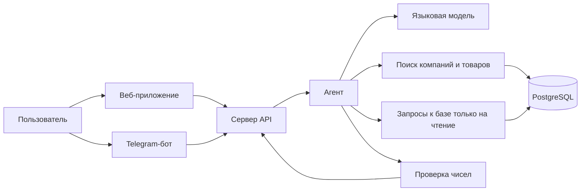

# UZEXify — ИИ-агент для ответов на вопросы о биржевых сделках

Описание решения. Оформлено по структуре ГОСТ 7.32-2017 в сокращённом виде.

Веб-версия: <https://uzex.d3d.uz> — открывается без установки и регистрации.

## Реферат

Агент отвечает на вопросы о 500 000 сделок Узбекской республиканской товарно-сырьевой биржи за период
с 3 января 2022 года по 30 октября 2026 года. Вопросы принимаются на русском и узбекском языках
(латиница и кириллица), ответ даётся на языке вопроса. Каждое число в ответе вычисляется запросом к базе данных
и перед отправкой сверяется с результатом этого запроса. Если данных нет, агент прямо об этом говорит.

На контрольном наборе из 42 вопросов: верных ответов — 34 из 34, выдуманных ответов там, где данных нет, — 0,
язык ответа совпал в 42 случаях из 42. Медианное время ответа — около 8 с.

Ключевые слова: ИИ-агент, биржевые сделки, SQL, проверка чисел, русский язык, узбекский язык.

> **O‘zbekcha qisqacha.** UZEXify 500 000 ta birja bitimi bo‘yicha savollarga rus va o‘zbek (lotin va kirill)
> tillarida faqat ma’lumotlar asosida javob beradi. Har bir raqam SQL so‘rovi bilan hisoblanadi va javobdan oldin
> tekshiriladi. Ma’lumot bo‘lmasa, agent buni ochiq aytadi. Nazorat savollarida: 34 tadan 33 ta to‘g‘ri javob,
> ma’lumot yo‘q savollarda o‘ylab topilgan javob — 0.

## Термины и определения

- **Агент** — программа на основе языковой модели, которая сама выбирает, какие запросы к данным выполнить, и
  формулирует ответ.
- **Основание ответа** — SQL-запрос и строки результата, из которых получен ответ; показываются пользователю
  под каждым ответом.
- **Проверка чисел** — сверка каждого числа в тексте ответа с результатами запросов этого же ответа.
- **Аннулированная сделка** — сделка со статусом «Аннулирован (Не оплачен)», то есть фактически не состоявшаяся.

## Введение

Задача — дать сотрудникам и участникам биржи способ получать точные ответы по реестру сделок обычными словами,
без знания SQL. Главное требование — не выдумывать: неверное число, компания или товар хуже, чем честное
«таких данных нет». Поэтому решение построено так, что модель не может вставить в ответ число, которого нет
в результатах запроса к базе.

## 1 Что умеет агент

1.1 Считать количество, суммы, объёмы, средние цены и доли за любой период: по товарам, компаниям, брокерам,
регионам, типам торгов и статусам сделок.

1.2 Находить компанию или товар в любой письменности и с опечатками: «ҲАРАЙЎМ КИМЁ» и «Harayo‘m Kimyo» —
одна компания, «bug‘doy» — пшеница.

1.3 Переспрашивать, если названию соответствует несколько компаний, и предлагать варианты.

1.4 Вести диалог: уточняющие вопросы вида «а по месяцам?», «покажи на графике» продолжают тему предыдущего.

1.5 Строить графики (линии, столбцы, панели) только из строк выполненного запроса.

1.6 Пересчитывать долларовые сделки в сумы по курсу на дату сделки.

1.7 Отвечать «нет данных» на вопросы о людях и контактах, прогнозах и периодах вне реестра.

## 2 Как устроено решение

Рисунок 1 — Схема решения

Порядок работы: агент находит в вопросе компании, брокеров и товары, составляет SQL-запрос, выполняет его
и пишет ответ. Перед отправкой каждое число ответа сверяется с результатом запроса. Пользователь видит ответ,
по желанию — график и основание ответа.

Таблица 1 — Использованные технологии

| Часть | Технология | Зачем |
|---|---|---|
| Языковая модель | GPT-6.1 Terra, запасная — Claude Sonnet 5.5 | Выбрана по результатам сравнения моделей (раздел 4) |
| Агент | Pydantic AI | Типизированные инструменты и встроенная проверка ответа с повтором |
| База данных | PostgreSQL 18 с pgvector | Сделки и векторные представления товаров в одной базе |
| Поиск компаний | Триграммы по общему латинскому ключу имени | Точно сравнивает имена в разных письменностях и честно отвечает «не найдено» |
| Поиск товаров | Триграммы и векторы Gemini Embedding 2 | Понимает узбекские названия товаров: bug‘doy, paxta, o‘g‘itlar |
| Сервер | FastAPI | Отдаёт ответ и живые шаги работы агента |
| Веб | Next.js 16, React 19 | Чат, графики, основание ответа, работа на телефоне |
| Бот | aiogram 3 | Тот же сервер, графики картинкой |
| Наблюдаемость | Langfuse Cloud | Запись каждого шага агента для разбора ошибок |
| Размещение | Docker Compose, Caddy (HTTPS) | Один сервер, наружу открыты только порты 80 и 443 |

## 3 Защита от выдуманных ответов

3.1 Доступ к базе только на чтение: отдельная роль, транзакции только для чтения, ограничение времени запроса.

3.2 Проверка SQL перед выполнением: допускается один запрос SELECT к таблицам реестра; изменение данных и
служебные функции запрещены.

3.3 Проверка чисел: каждое число ответа («106 647», «13,16 трлн сумов», «6,98 %») должно совпасть с результатом
запроса с точностью до показанного разряда. Иначе модель получает требование посчитать значение запросом.

3.4 Ответ без выполненного запроса невозможен.

3.5 Если компания или товар не найдены, агент сообщает об этом и не подставляет похожие.

3.6 Графики строятся сервером из строк запроса; модель передаёт только имена столбцов. Величины в разных
единицах (доллары и сумы, тонны и сделки) не ставятся на одну ось.

3.7 Если ответ не прошёл проверку, пользователь видит предупреждение и результат запроса вместо текста модели.

## 4 Проверка качества

4.1 Контрольный набор — 42 вопроса на трёх письменностях: 34 с ответом, 6 без данных (2021 и 2027 годы,
несуществующая компания, директор и телефон, золото, курс евро), 2 с неоднозначным названием компании.
Эталонные значения считаются SQL-запросами в момент проверки.

Таблица 2 — Сравнение языковых моделей на контрольном наборе

| Модель | Верные ответы | Выдуманные ответы без данных | Уточнения | Язык ответа | 95 % ответов быстрее |
|---|---|---|---|---|---|
| **GPT-6.1 Terra** (выбрана) | 34 из 34 | 0 | 2 из 2 | 42 из 42 | 16 с |
| Gemini 3.8 Flash | 34 из 34 | 0 | 1 из 2 | 41 из 42 | 33 с |
| GPT-6 Luna | 31 из 34 | 1 | — | — | — |
| Claude Haiku 5.5 | 20 из 34 | 1 | — | — | — |

Проверка текстовых значений учитывает падежные окончания: «в Ферганской области» засчитывается как
«Ферганская область».

4.2 Диалоги. Три сценария по шесть ходов с уточнениями, местоимениями и сменой языка посреди разговора:
все 18 ходов пройдены.

4.3 Стиль ответов. 64 вопроса оценены автоматическими правилами оформления (без нарушений во всех 64) и
моделью-редактором по шкале 1–10: средняя оценка 8,3, ниже 7 — ни одного ответа. Нормы оформления описаны
в `docs/style.md`.

4.4 Поиск товаров на 52 упоминаниях в трёх письменностях: верный товар в первой пятёрке — в 93,3 % случаев.
Поиск компаний: 100 % верных совпадений, 0 ложных на выдуманных названиях.

Отчёты всех прогонов лежат в `backend/evals/reports/`.

## 5 Интерфейсы

5.1 Веб-приложение — <https://uzex.d3d.uz>: чат на русском и узбекском, живые шаги работы агента, выбор глубины
размышлений, графики со скачиванием в PNG, раскрываемое основание ответа с SQL и таблицей. Работает на
телефоне.

5.2 Telegram-бот использует тот же сервер: показывает ход работы, присылает ответ с основанием и график
картинкой.

## Заключение

Решение отвечает на вопросы о сделках биржи на русском и узбекском языках, каждое число в ответе подтверждено
запросом к данным, а отсутствие данных признаётся явно. Качество измерено на контрольном наборе, диалогах и
оценке стиля; выбор модели и способа поиска сделан по результатам измерений.
